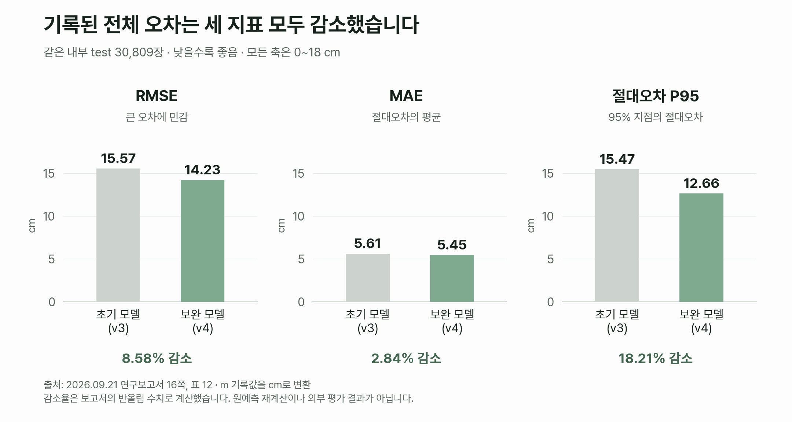
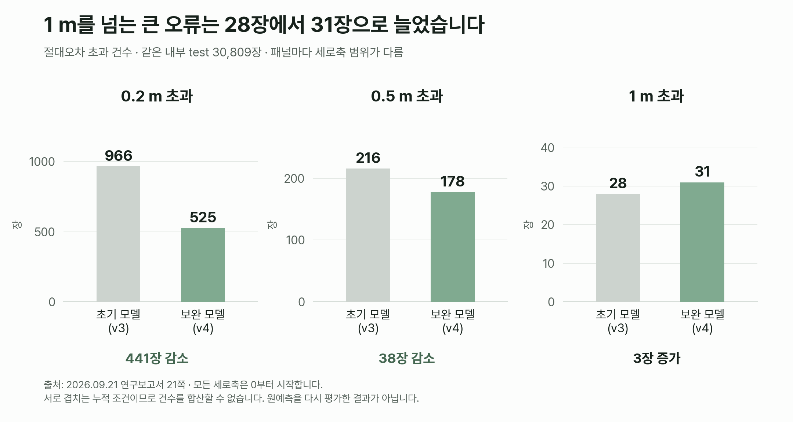

# 데이터분석의 재시작

### 사진에서 수위를 읽는 AI, 그리고 틀린 예측을 다시 살펴본 과정

2026 데이터크리에이터캠프에서 **목자판 사진으로 수위를 예측하는 모델**을 만들었습니다. 목자판은 물 높이를 읽는 눈금판입니다. 사진 속 눈금이 작거나, 물에 비친 눈금과 실제 눈금이 겹치면 수위를 판단하기 어려워집니다.

이 저장소에는 데이터를 점검하고 모델을 비교한 Colab 코드, 결과를 보고 방법을 바꾼 이유, 마지막까지 남은 오류를 정리했습니다. 처음 읽는 분은 아래의 수행 과정을, 코드를 보고 싶은 분은 노트북 안내를 먼저 열어 보시면 됩니다.

**[수행 과정 읽기](docs/research-process.md) · [Colab 코드와 실행 안내](notebooks/README.md) · [결과 그래프 직접 만들어 보기](notebooks/00_read_results.ipynb) · [연구보고서](reports/research-report.pdf)**

## 어떤 프로젝트인가요?

| 질문 | 이 프로젝트에서 한 일 |
|---|---|
| 무엇을 입력하나요? | 목자판이 찍힌 사진과 목자판의 유형 |
| 무엇을 예측하나요? | 미터 단위의 수위 |
| 어떤 자료를 다뤘나요? | AI-Hub Training 이미지와 정답 JSON 308,085쌍 |
| 어떤 방법을 비교했나요? | 세 CNN 후보, 전체 사진과 목자판 확대 입력, 장애물 보조 학습 |
| 무엇을 함께 살펴봤나요? | 전체 점수, 유형별 오차, 같은 사진의 예측 변화와 큰 실패 사례 |

## 어떻게 진행했나요?

### 1. 파일 수를 센 뒤, 실제로 쓸 수 있는 데이터인지 확인했습니다

이미지와 정답 파일의 수가 같아도 내용까지 정상이라는 보장은 없었습니다. 압축 파일을 검사하고 이미지를 읽어 보면서, 확장자와 실제 저장 형식이 다른 사진과 읽기에 실패한 사진을 구분했습니다. 같은 이미지에 서로 다른 수위 정답이 붙은 경우도 별도로 기록했습니다.

같은 사진이 학습 자료와 평가 자료에 나뉘지 않도록 이미지 내용의 해시로 그룹을 만들고 함께 분할했습니다. 이 과정을 거쳐 모델에 사용할 자료와 제외 사유를 추적할 수 있도록 관리 목록을 구성했습니다.

→ [데이터 점검에서 발견한 문제와 처리 기준](docs/research-process.md)

### 2. 세 모델을 비교하고, 작은 눈금을 더 잘 볼 방법을 찾았습니다

ResNet18, EfficientNet-B0, ConvNeXt-Tiny를 수위 예측 후보로 정했습니다. 세 모델은 사진의 모양과 패턴을 학습하는 CNN이지만, 특징을 추출하는 구조와 모델 규모가 다릅니다. 구조에 대한 기대와 실제 검증 결과를 구분해 기본 모델을 선택했습니다.

전체 사진을 작게 줄이면 목자판의 가는 눈금도 함께 작아집니다. 그래서 목자판을 먼저 검출한 뒤 해당 영역을 확대해 예측하는 방법을 비교했습니다. 확대 입력의 효과는 유형마다 달라, 검증 결과에 따라 전체 사진과 확대 사진을 사용하는 경로를 나눴습니다.

→ [모델 비교와 관심영역 확대 코드](notebooks/README.md)

### 3. 큰 오류가 나온 사진을 보고 데이터 분포와 학습 방식을 보완했습니다

초기 모델의 오류를 분석하니 소수의 사진이 전체 제곱오차에서 큰 비중을 차지했습니다. 반사와 가림 같은 조건이 함께 나타난 사례를 보면서, 이 조건들이 학습과 검증 자료에 어떻게 분포하는지 다시 확인했습니다.

테스트 자료를 유지한 채 학습·검증 분포를 조정하고, 수위와 장애물의 존재 여부를 함께 학습하는 모델을 비교했습니다. 한 번에 여러 설정이 달라진 실험과, 같은 조건에서 보조 학습을 비교한 실험은 따로 설명했습니다.

→ [보완 실험에서 바뀐 내용과 비교할 수 있는 범위](docs/research-process.md)

### 4. 점수가 좋아진 뒤에도, 남은 실패를 함께 기록했습니다

아래는 **연구보고서에 기록된 동일 내부 테스트 30,809장의 비교**입니다. 이 테스트는 초기 오류 분석에 이미 사용됐으므로, 개발 과정 내내 보지 않았던 외부 평가 자료를 뜻하지 않습니다.

| 지표 | 초기 모델 | 보완 모델 | 보고서의 변화율 |
|---|---:|---:|---:|
| RMSE | 0.155691 m | 0.142334 m | 8.58% 감소 |
| MAE | 0.056090 m | 0.054499 m | 2.84% 감소 |
| 절대오차 P95 | 0.154746 m | 0.126563 m | 18.21% 감소 |

RMSE는 큰 오차에 더 큰 비중을 두는 지표입니다. MAE는 절대오차의 평균이고, P95는 절대오차를 작은 순서로 놓았을 때 95% 지점의 값입니다. 서로 다른 부분을 보여주기 때문에 함께 확인했습니다.

전체 RMSE는 줄었지만 **1 m를 초과한 오류는 28장에서 31장으로 늘었습니다.** 개선된 제곱오차는 C형 사진 두 장에 크게 집중됐습니다. 평균 지표와 사진별 변화를 함께 살펴보며, 큰 실패에 대한 안정성은 아직 남은 문제로 정리했습니다. 위 초과 건수는 서로 겹치는 누적 집계이므로 더해서 전체 건수로 해석하지 않습니다.

> 그래프는 보고서의 집계값으로 다시 그렸습니다. 현재 저장소에는 원시 예측·잔차 파일이 없어, 여기서 전체 테스트 지표를 원예측으로 다시 계산한 것은 아닙니다. 재분할과 여러 학습 설정도 함께 바뀌었으므로 전체 개선을 장애물 보조 학습 하나의 효과로 설명하지 않습니다.

## 코드를 직접 보고 싶다면

**실제로 사용한 Colab 노트북 11개**를 공개 사본으로 정리했습니다. 저장된 텍스트 출력은 보존하고, 개인 클라우드 설정과 이미지 출력은 공개 범위에 맞게 정리했습니다. 각 파일의 원래 이름과 변경 내역도 남겼습니다.

| 하고 싶은 일 | 시작할 곳 |
|---|---|
| 데이터 없이 결과 그래프를 만들어 보고 싶어요 | [결과 읽기 노트북](notebooks/00_read_results.ipynb) · [Colab에서 열기](https://colab.research.google.com/github/Pirite08/dcc-2026-water-level-estimation/blob/main/notebooks/00_read_results.ipynb) |
| 실제 대회 코드를 읽고 싶어요 | [노트북별 역할과 원본 대응표](notebooks/README.md) |
| 제 환경에서 학습·평가 코드를 실행하고 싶어요 | [Colab 준비와 실행 순서](docs/colab-guide.md) |
| 현재 어디까지 재현할 수 있는지 궁금해요 | [재현 상태와 확보하지 못한 자료](docs/reproducibility.md) |
| 수치의 근거를 확인하고 싶어요 | [보고서·저장 출력·원시 산출물의 구분](docs/evidence.md) |

결과 읽기 노트북은 공개 CSV로 그래프와 변화율을 확인하는 CPU 예제입니다. 학습 노트북을 실행하려면 원 데이터 접근 권한과 단계별 산출물, 개인 클라우드 설정이 필요합니다. 현재 확보한 파일을 모두 순서대로 실행하면 당시 결과가 그대로 재현된다고 안내하지는 않습니다.

## 팀과 기록

팀명은 **데이터분석의 재시작**입니다. 결과가 예상과 다르면 질문과 기준부터 다시 살피고, 이전의 시행착오를 다음 판단의 근거로 삼자는 뜻을 담았습니다.

연구보고서의 작성자는 **김태환, 백승우, 신동건, 구승훈**입니다. 이 저장소는 팀의 프로젝트 기록을 포트폴리오 형태로 정리한 공개본입니다. 개인별 역할은 현재 확보한 자료만으로 추정하지 않았습니다.

→ [팀 소개와 기여 기록의 범위](docs/team.md)

## 발표자료와 더 자세한 설명

- [최종 연구보고서 PDF](reports/research-report.pdf): 문제 정의, 구현, 비교 실험과 오류 분석
- [수행 과정 문서](docs/research-process.md): 문제를 발견하고 판단 기준을 바꾼 과정
- [결과 CSV와 그래프의 출처](results/README.md): 집계값과 그림을 확인하는 방법
- [자료 포함 범위](reports/README.md): 연구보고서와 발표자료의 현재 확보 상태
- [출처와 공개 범위](NOTICE.md)

현재 공개본에는 연구보고서를 포함했습니다. 최종 발표 PDF/PPTX는 확보 후 별도로 추가할 자료이며, 과거 디자인 시안이나 화면 캡처를 최종 제출본으로 대신 올리지 않았습니다.

---

이 저장소의 공개 정리일은 **2026-11-26**입니다. 대회 당시 코드와 2026-09-21 연구보고서를 정리한 것이며, 공개 준비 과정에서 모델을 새로 학습하거나 대회 성적을 다시 평가한 것은 아닙니다.
