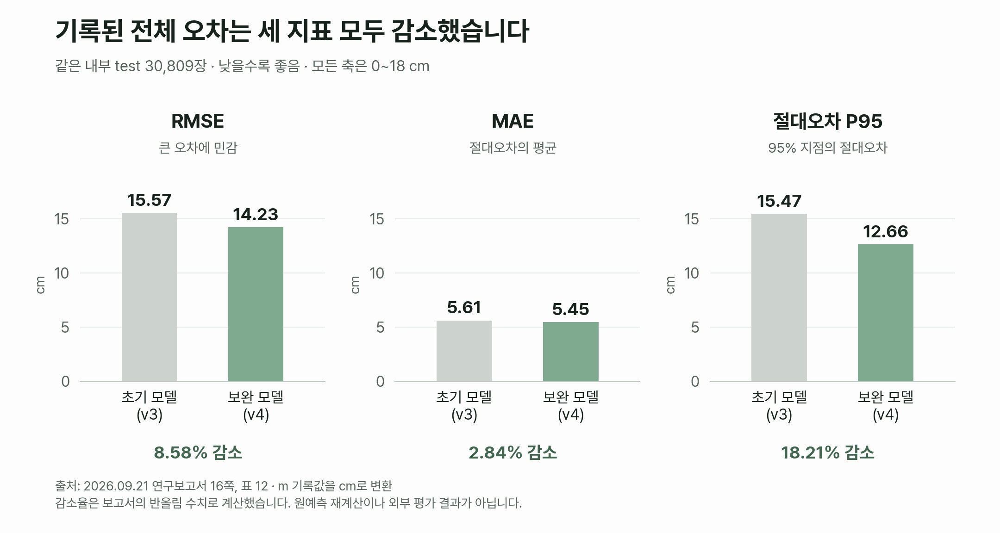
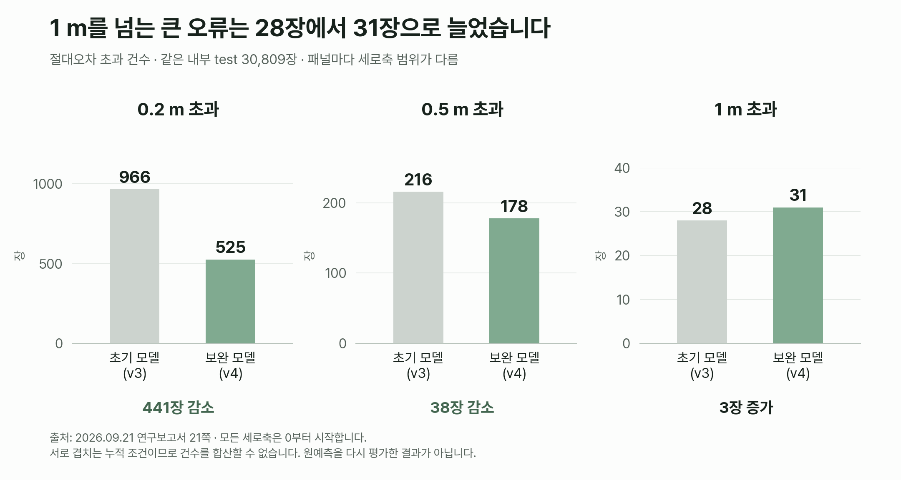

# 보고서에 기록된 결과

이 폴더는 [2026년 9월 21일 연구보고서](../reports/research-report.pdf)의 집계값을 옮긴 자료입니다. 원래의 이미지별 예측 파일에서 성능을 다시 계산한 결과가 아닙니다. 공개 준비 과정에서는 모델 학습이나 추론을 실행하지 않았습니다.

| 파일 | 담긴 값 | 보고서 위치 |
| --- | --- | --- |
| [overall_metrics.csv](overall_metrics.csv) | 같은 내부 test 30,809장의 v3·v4 RMSE, MAE, 절대오차 P95 | PDF 16쪽, 표 12 |
| [error_threshold_counts.csv](error_threshold_counts.csv) | 절대오차 0.2 m·0.5 m·1 m **초과** 건수 | PDF 21쪽, 본문과 그림 13 |
| [provenance.json](provenance.json) | 출처, 단위, 계산 범위와 원본 해시 | 이 공개본의 출처 기록 |

v3는 초기 전체 학습 모델이고 v4는 학습·검증 분포를 조정한 뒤 수위와 장애물을 함께 학습한 모델입니다. 보고서는 두 버전의 test sample ID, 유형, 정답이 일치한다고 기록했습니다. 이 공개본에서는 해당 이미지별 파일을 독립적으로 대조하지 못했습니다.

| 지표 | v3 기록 | v4 기록 | 기록된 반올림 수치로 계산한 감소율 |
| --- | ---: | ---: | ---: |
| RMSE | 0.155691 m | 0.142334 m | 8.58% |
| MAE | 0.056090 m | 0.054499 m | 2.84% |
| 절대오차 P95 | 0.154746 m | 0.126563 m | 18.21% |

감소율은 `(v3 − v4) / v3 × 100`입니다. 원래 보고서에 소수점 여섯 자리로 표시된 값에서 계산하며, 반올림 전 원예측으로 계산한 변화율과는 미세하게 다를 수 있습니다. 그림에서는 읽기 쉽도록 m에 100을 곱해 cm로 표시하고 소수점 둘째 자리까지 보여 줍니다. CSV에는 보고서의 m 단위와 여섯 자리 표기를 보존했습니다.



| 절대오차 조건 | v3 | v4 | 건수 변화 |
| --- | ---: | ---: | ---: |
| 0.2 m 초과 | 966 | 525 | −441 |
| 0.5 m 초과 | 216 | 178 | −38 |
| 1 m 초과 | 28 | 31 | +3 |

세 조건은 **서로 겹치는 누적 집계**입니다. 예를 들어 1 m 초과 영상은 0.5 m 초과와 0.2 m 초과에도 포함되므로 세 건수를 더하면 안 됩니다.



## 어디까지 다시 확인할 수 있나요?

[결과 읽기 노트북](../notebooks/00_read_results.ipynb)은 공개 CSV를 읽고 단위 변환, 변화율, 초과 건수의 순서와 범위를 확인합니다. 그래프도 CPU에서 다시 생성합니다. 같은 작업을 저장소 루트에서 실행하려면 다음을 사용합니다.

```bash
python -m pip install matplotlib
python tools/plot_recorded_results.py
```

CSV의 값을 원예측에서 다시 산출하는 것은 이 경로에 포함되지 않습니다. 원래 예측과 정답 파일을 복구하지 못했으므로 RMSE·MAE·P95 자체의 독립 재계산, 이미지별 오류 대조, 모델 재현을 완료했다고 주장할 수 없습니다. 또한 test는 v3 오류 분석에 사용된 내부 고정 자료이므로 새로운 촬영 환경에서의 성능을 뜻하지 않습니다. 전체 지표가 줄어도 1 m 초과 오류는 28장에서 31장으로 늘었습니다.

## 출처 해시

해시는 자료의 동일성을 확인하는 값이며, 보고서에 적힌 성능을 독립적으로 검증하는 증거는 아닙니다.

| 출처 | SHA-256 |
| --- | --- |
| 배포 보고서 PDF 원본 | `f16e3270a11ced6c876369d6ea017c576f79924a550e1895bbafc27b6b5d9667` |
| 집계 전사에 사용한 텍스트 추출본 | `af29ad5f667c87503dc4ab29cfad1fe195f19565ffa7dc1986d915660e4337b3` |

텍스트 추출본은 작업용 자료이므로 이 저장소에 배포하지 않습니다. 차트의 SVG 버전은 [지표 비교](../assets/recorded_metrics.svg)와 [초과 건수 비교](../assets/recorded_error_counts.svg)에서 볼 수 있습니다. 기본 차트는 실제 Pretendard 글꼴로 생성했으며 SVG는 글자를 경로로 저장해 보는 환경에 해당 글꼴이 없어도 표시됩니다. 다시 생성할 때는 로컬 Pretendard 또는 다른 한글 글꼴을 사용합니다. 한글 글꼴이 없는 환경에서는 영문 라벨로 생성합니다.
